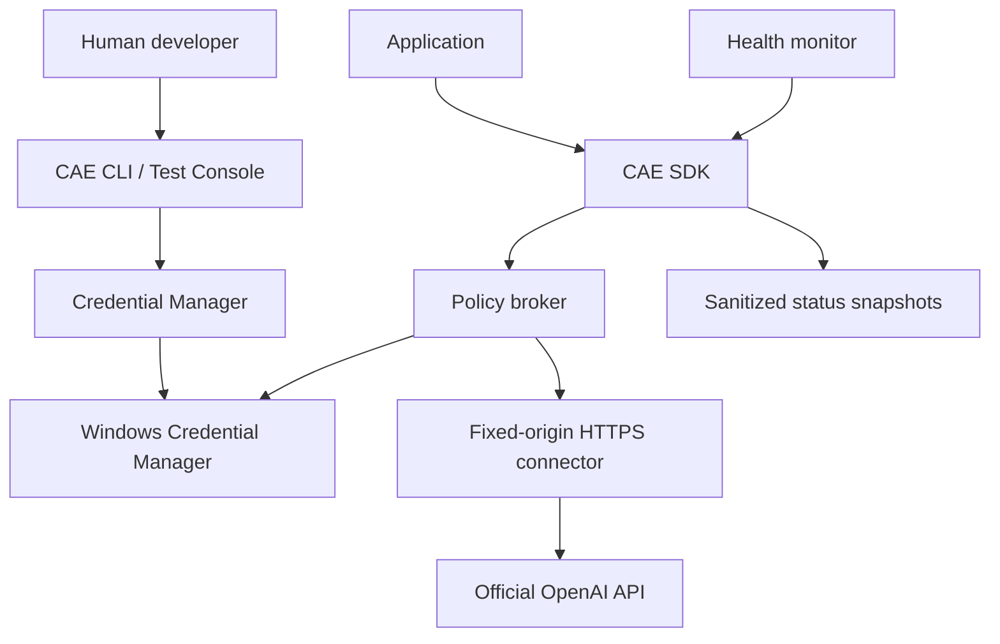

# CAE architecture

Version 0.2.0 provides a synchronous SDK, native Windows credential backend,
in-process policy broker, bounded HTTPS connector, diagnostic snapshots, explicit
health monitoring, CLI and a separate human-operated test console.

Codex CLI is a development tool outside the runtime graph. Its login state is not
read or modified. CAE credentials belong to the current Windows account, using
`CAE/openai/<profile>` targets and `CRED_TYPE_GENERIC` with local-machine persistence
(user scoped, survives logoff, does not roam).

## Module ownership

| Module | Responsibility |
|---|---|
| `credential.py` | Store protocol, Win32 bindings, verified writes, lifecycle/import |
| `security.py` | Identifier/key syntax checks and recursive redaction |
| `api.py` | TLS, fixed origin/routes, bounded response reads, retry/error policy |
| `broker.py` | Immutable explicit grants, deny-before-read, bounded metadata audit |
| `engine.py` | Public SDK, schema validation, status and request composition |
| `monitor.py` | Opt-in polling with explicit lifecycle |
| `cli.py`, `gui.py` | Human administration and diagnostics |

All executable library code lives in `src/cae`. Root-level component directories
hold navigation/design notes; there are no duplicate Python package trees.

## Decisions

1. Use Win32 Credential Manager directly through typed `ctypes` declarations to
   avoid a configurable keyring backend silently selecting plaintext storage.
2. Use standard-library HTTPS with system certificate validation, a fixed origin,
   no redirects and no environment proxy support. This reduces configuration paths
   that could send an authorization header to an unintended endpoint.
3. Separate administrator lifecycle methods from the application SDK. Only trusted
   infrastructure code implements `CredentialStore.read`; consuming applications
   use broker operations and never receive a stored secret.
4. In-process grants are policy coordination, not authenticated process identity.
   The host composes grants. A separate Windows service identity and authenticated
   IPC require a later implementation and independent security review.
5. Probe with one model-list GET, no generation. Retry safe model-list operations
   at most three times after the initial attempt; never automatically replay POST.
6. Do not persist request bodies, responses, full exceptions or credential-derived
   diagnostics. Audit records contain only timestamp and fixed outcome.
7. Shipping artifacts are explicitly built from `src/cae` and a GUI launcher.
   No wildcard repository data inclusion is permitted.

## Concurrency and extension

The credential manager serializes lifecycle calls on a manager instance. Windows
performs each stored credential write; cross-process compare-and-swap lifecycle
transactions are not provided. Treat each profile as having one provisioning owner.
HTTP connections are created per call. Broker audit and engine health snapshots use
locks. Monitor start is idempotent; stop waits for the in-flight bounded call.

`CredentialStore` and `Transport` are trusted dependency-injection seams. Never
load their implementations from untrusted application-controlled configuration.
Future providers should use separate connector implementations and explicitly
scoped policies rather than making this connector's origin arbitrary.
