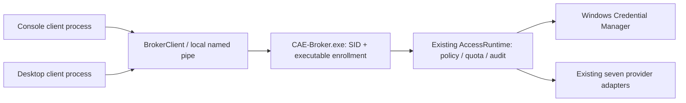
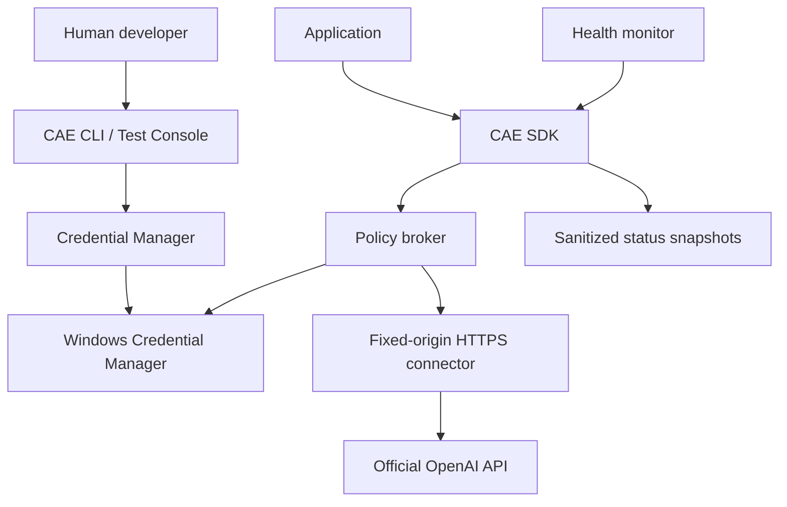

# CAE architecture

## M4 partial operator interface

`operator_view.py` pins an explicitly selected broker's image/hash, pipe and runtime
path. Restoring a portable selection is offline; a user action invokes the existing
mutually verified BrokerClient. Application administration delegates to the existing
ApplicationRegistry, which authenticates the actual operator executable on each
operation. No new administrative IPC operation, self-enrollment or provider probe
is added. The GUI's retained in-process pages are explicitly separate. Missing
provisioning and graphical authorization/routing controls keep M4 PARTIAL.

## M3 packaged local inference

The OpenAI-compatible adapter is reused with an exact operator-allowlisted llama.cpp model ID. Windows backslashes are opaque model characters, never filesystem authority. HTTP declared-length truncation fails closed even if partial bytes form valid JSON. The one-shot console probe uses the public SDK and unchanged protocol v1. See [M3 evidence](docs/validation/LOCAL-INFERENCE-M3-PACKAGED.md).

## 0.5.0.dev4 capability routing

`routing.py` provides a versioned registry and deterministic selector over existing
provider adapters and policy rules. Broker operations `capabilities`/`route` are
additive to protocol v1. Selected calls enter the existing AccessRuntime, quota,
concurrency, audit and vault path. Configuration opt-in is mandatory; no production
migration or new service. See [routing contract](docs/CAPABILITY_ROUTING.md).

## 0.5.0.dev3 managed audit storage

The existing AuditLog delegates opt-in disk retention to `audit_storage.py`. Broker
and administrative logs use separate private manifest-owned roots; quotas and
enrollment never share deletion scope. JSONL fields and protocol v1 are unchanged.
Managed writes serialize across threads/processes and flush before returning.
See [the retention contract](docs/validation/AUDIT-M1-RETENTION-ROTATION.md) for
resource bounds, recovery states and deliberately limited durability guarantees.

## 0.5.0.dev2 audit correlation

The broker establishes a fresh ContextVar request scope before parsing/authentication.
Nested AccessRuntime execution reuses it; direct execution creates its own scope.
Audit IDs are generated by CAE, separate from protocol v1 wire IDs. New metadata is
allowlisted and legacy rows remain readable. No new client operation is introduced.
See [M1 limitations and tests](docs/validation/AUDIT-M1.md). Storage rotation remains
unfinished. Supervisor shutdown now waits for the authenticated broker PID to exit.

## 0.5.0.dev1 administrative increment

`registry.py` administers the existing enrollment JSON and policy TOML; it does not
create another broker or expose administrative IPC endpoints. Commands authenticate
the operator's actual executable against an existing admin enrollment, serialize
edits with a Windows file lock, and preserve destination file DACLs on replacement.
The broker reloads enrollment before each request while pinning its server identity,
pipe and runtime path until restart. Already accepted requests are not cancelled.

The existing SQLite quota transaction now reserves daily and UTC-minute counters
atomically. Per-rule concurrent provider slots are acquired and released by the
runtime around each provider operation, including failure paths. Older rules remain
valid; minute/concurrency limits are opt-in. See [administration](docs/APPLICATION_REGISTRY.md).

## Universal client development

`clients/` contains public Python, .NET, C++, Node.js and PowerShell SDKs. All use
the existing protocol v1 and kernel-authenticated named pipes; the broker is not
duplicated. Python composes the exported BrokerClient. C# and C++ implement native
client transport; PowerShell loads the .NET SDK and Node uses an in-process Node-API
binding to the C++ SDK. No helper process masks the calling application's identity.
External applications in `integration-lab/` import only these public interfaces.
See [client contracts and recovery](docs/CLIENT_SDKS.md).

## v0.3.1 independent broker

`pipe_transport.py` provides native overlapped I/O and kernel peer identity;
`ipc_protocol.py` validates framed JSON and explicit enrollment; `broker_client.py`
is the public client SDK; `broker_service.py` owns the runtime and eight connection
workers; `broker_control.py` supervises startup/shutdown without system installation.
`examples/broker_console.py` and `examples/broker_desktop.py` import only the public
SDK and build into separate application EXEs. The service does not import either UI.

No broker code relies on Codex CLI, Control Center, a calling application lifecycle,
environment API keys or changes to Windows authentication. The existing `CAE()`
composition remains backward compatible and explicitly in-process. This broker runs
under the current Windows account; separate service-account isolation is not implemented.
See [protocol](docs/BROKER_PROTOCOL.md) for trust boundaries and failure behavior.

## Previous architecture and compatibility

For the current CODEX ACCESS ENGINE v0.3.0 architecture, see
[Access Engine](docs/ACCESS_ENGINE.md) and [policy/audit design](docs/POLICY_AUDIT.md).
The v0.2.0 architecture below documents the retained compatibility interfaces.

Version 0.2.0 provides a synchronous SDK, native Windows credential backend,
in-process policy broker, bounded HTTPS connector, diagnostic snapshots, explicit
health monitoring, CLI and a separate human-operated test console.

Codex CLI is a development tool outside the runtime graph. Its login state is not
read or modified. CAE credentials belong to the current Windows account, using
`CAE/openai/<profile>` targets and `CRED_TYPE_GENERIC` with local-machine persistence
(user scoped, survives logoff, does not roam).

## Module ownership

| Module | Responsibility |
|---|---|
| `credential.py` | Store protocol, Win32 bindings, verified writes, lifecycle/import |
| `security.py` | Identifier/key syntax checks and recursive redaction |
| `api.py` | TLS, fixed origin/routes, bounded response reads, retry/error policy |
| `broker.py` | Immutable explicit grants, deny-before-read, bounded metadata audit |
| `engine.py` | Public SDK, schema validation, status and request composition |
| `monitor.py` | Opt-in polling with explicit lifecycle |
| `cli.py`, `gui.py` | Human administration and diagnostics |

All executable library code lives in `src/cae`. Root-level component directories
hold navigation/design notes; there are no duplicate Python package trees.

## Decisions

1. Use Win32 Credential Manager directly through typed `ctypes` declarations to
   avoid a configurable keyring backend silently selecting plaintext storage.
2. Use standard-library HTTPS with system certificate validation, a fixed origin,
   no redirects and no environment proxy support. This reduces configuration paths
   that could send an authorization header to an unintended endpoint.
3. Separate administrator lifecycle methods from the application SDK. Only trusted
   infrastructure code implements `CredentialStore.read`; consuming applications
   use broker operations and never receive a stored secret.
4. In-process grants are policy coordination, not authenticated process identity.
   The host composes grants. A separate Windows service identity and authenticated
   IPC require a later implementation and independent security review.
5. Probe with one model-list GET, no generation. Retry safe model-list operations
   at most three times after the initial attempt; never automatically replay POST.
6. Do not persist request bodies, responses, full exceptions or credential-derived
   diagnostics. Audit records contain only timestamp and fixed outcome.
7. Shipping artifacts are explicitly built from `src/cae` and a GUI launcher.
   No wildcard repository data inclusion is permitted.

## Concurrency and extension

The credential manager serializes lifecycle calls on a manager instance. Windows
performs each stored credential write; cross-process compare-and-swap lifecycle
transactions are not provided. Treat each profile as having one provisioning owner.
HTTP connections are created per call. Broker audit and engine health snapshots use
locks. Monitor start is idempotent; stop waits for the in-flight bounded call.

`CredentialStore` and `Transport` are trusted dependency-injection seams. Never
load their implementations from untrusted application-controlled configuration.
Future providers should use separate connector implementations and explicitly
scoped policies rather than making this connector's origin arbitrary.
