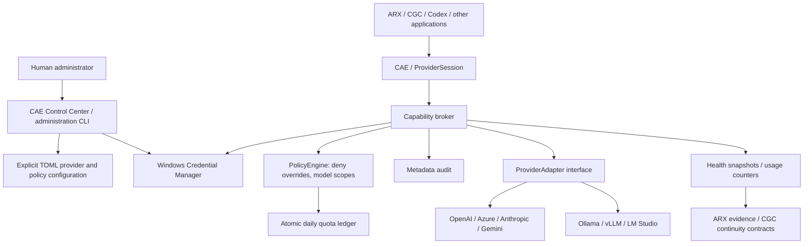

# CODEX ACCESS ENGINE v0.3.0

This guide documents the retained in-process API. v0.3.1 adds the independent
[named-pipe broker and BrokerClient](BROKER_PROTOCOL.md) without replacing this API.

CAE separates applications from credentials. The application SDK requests operations;
the trusted runtime validates policy, records its decision, reserves quota, acquires
the appropriate credential internally and calls a provider adapter. No application
SDK method accepts or returns a provider credential. Human administration is separate.



## SDK and CLI

`CAE()` creates a read-only OpenAI console runtime. No key is imported, no credential
is written, and no network request happens during construction. Explicit configuration:

```python
from pathlib import Path
from cae import CAE

engine = CAE(app="arx", config=Path("examples/access.toml"))
health = engine.health()                  # Offline; timestamp marks last observation
diagnostics = engine.diagnostics()        # Offline
providers = engine.providers()            # Visible to this app/profile
connection = engine.connect()             # One model-list request, explicit
provider = engine.provider("openai")
# Only on an intentional application action; subject to model policy:
# response = provider.chat("gpt-5", "Explain this evidence", max_output_tokens=128)
# vectors = provider.embeddings("approved-embedding-model", "evidence text")
usage = provider.usage()                  # Observed in this runtime, not billing data
engine.close()
```

Policy examples name models, but do not guarantee the user's account has model
access. Every provider operation is still subject to the provider's own permissions.
Chat is currently a single user-text request; no tools, streaming or agent execution.

```powershell
cae health
cae status
cae providers
cae diagnostics
cae connect
cae broker
cae audit
cae policies
cae --config examples/access.toml --app arx --provider openai diagnostics
```

Without a configuration file, policy/quota/audit state is in memory for that runtime.
With an explicit TOML file, quota and metadata audit persist in `.cae/` beside the file.
Do not share writable policy/configuration directories with untrusted applications.
There is no implicit search for configuration in arbitrary current directories.

## Control Center

Run `cae-control-center` or `dist/0.3.0/CAE-Control-Center.exe`. The five pages cover
overview/health, provider inspection and selection, masked credential administration,
administrative audit, and validated TOML policy/provider editing. Network and credential
actions run off the UI thread. The default GUI connection profile is `default`; CLI/SDK
support explicit additional profiles. Editing policies is a human host-administration
operation, never an application capability.

The old `cae-console` entry point remains available as the legacy test console.

## Runtime modules

`access.py` is the new capability broker. `policy.py`, `audit.py`, `providers.py` and
`config.py` implement independent components. `engine.py` is the secret-free SDK.
`credential.py` preserves the existing OpenAI vault namespace and adds isolated
namespaces for other provider kinds. `broker.py`/`api.py` remain as explicit v0.2
trusted-host compatibility interfaces.

## Limits

This remains an in-process trusted-host architecture. A caller-supplied app label
is not authenticated process identity; hostile code under the same Windows account
can bypass Python policy or access user-scoped Windows credentials. A separate service
identity, authenticated IPC and external security review remain future work. No remote
broker, autonomous agent or universal trust authority is claimed.
